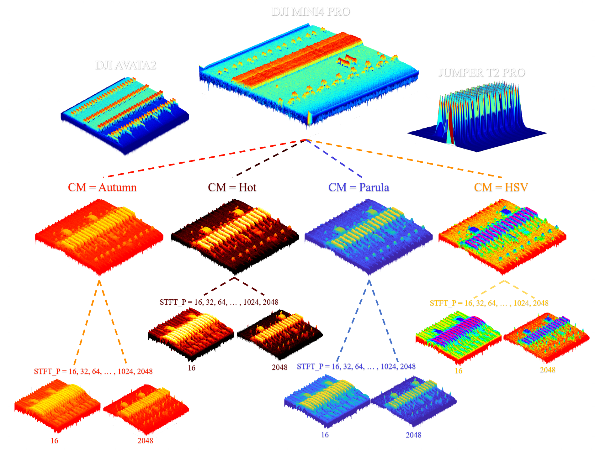

<h1 style="text-align:center;"> The RFUAV DATASET </h1>

<div style="text-align: center; margin: 10px 0;">
  <a href="README_zh.md" style="text-decoration: none; color: var(--link-color); font-size: 16px;">📖 中文版</a>
</div>

## Abstract

The official repository for our paper, *"[RFUAV: A Benchmark Dataset for Unmanned Aerial Vehicle Detection and Identification](https://arxiv.org/abs/2503.09033)"*, can be accessed here. RFUAV offers a comprehensive benchmark dataset for Radio-Frequency (RF)-based drone detection and identification.
  


In addition to the dataset, we provide the raw data used to generate the spectral information, which includes recordings from 35 different types of drones under high signal-to-noise ratio (SNR) conditions. This dataset is available to all researchers working with RF data for drone analysis. Researchers can apply the deep learning methods we have provided, or use traditional signal processing techniques such as decoding, demodulation, and FFT.

Detailed information about the dataset, including file sizes (total data volume for each drone), SNR (the highest SNR for each dataset), and the middle frequency (the central frequency used during data collection for each drone), is provided in the figure below.

  

We analyzed the properties of each drone in the dataset, including Frequency Hopping Signal Bandwidth (FHSBW), Frequency Hopping Signal Duration Time (FHSDT), Video Transmitted Signal Bandwidth (VSBW), Frequency Hopping Signal Duty Cycle (FHSDC), and Frequency Hopping Signal Pattern Period (FHSPP). The distributions of these properties are plotted below. More detailed information can be found in our paper.

  

With RFUAV, you can achieve drone signal detection and identification directly on raw IQ data, as demonstrated below:
    <div style="text-align:center;">
        
    </div>

## 1. Quick Start
<details>
<summary>Installation</summary>

```bash
pip install -r requirements.txt
```

</details>

<details>
<summary>Run inference for drone classification</summary>

```bash
python inference.py --task classify --cfg configs/exp1.1_ResNet18.yaml --weight-path path/to/best_model.pth --source path/to/data --save-path ./res/
```

</details>

<details>
<summary>Quick training using ResNet50 on a small dataset</summary>

```bash
python train.py --cfg configs/exp1.1_ResNet18.yaml
```

</details>

## 2. Usage

### CLI Entrypoints

```bash
# Classification training
python train.py --cfg configs/exp1.1_ResNet18.yaml

# Two-stage inference
python inference.py --task two_stage --two-stage-cfg example/two_stage/sample.json

# Benchmark evaluation
python benchmark.py --cfg configs/exp1.1_ResNet18.yaml --weight-path path/to/best_model.pth --data-path path/to/benchmark --save-path ./benchmark_res
```


### SDR Playback
Since our data was directly collected using USRP devices, it is fully compatible with USRP and GNU Radio for signal replay. You can use our raw data to broadcast signals through radio equipment to achieve your desired outcomes. Additionally, we provide the replay results observed during our experiments using an oscilloscope for reference.
    <div style="text-align:center;">
        
    </div>

### 2.1 Converting Raw Frequency Signal Data to Spectrograms

#### Python Pipeline

We provide a signal processing pipeline to convert binary raw frequency signal data into spectrogram format using both MATLAB and Python toolboxes.

**Visualize Spectrograms**

You can easily visualize the spectrogram of a specific data pack using the following code. The `oneside` parameter controls whether to display the half-plane or full-plane spectrogram.

```python
from graphic.RawDataProcessor import RawDataProcessor

datapack = 'Your datapack path'
test = RawDataProcessor()
test.show_spectrogram(data_path=datapack,
                      drone_name='DJI FPV COMBO',
                      sample_rate=100e6,
                      stft_point=2048,
                      duration_time=0.1,
                      oneside=False)
```

**Batch Conversion to Images**

To automatically convert raw frequency signal data into spectrograms and save them as PNG images:

```python
from graphic.RawDataProcessor import RawDataProcessor

data_path = 'Your datapack path'
save_path = 'Your save path'
test = RawDataProcessor()
test.trans_raw_data_into_spectrogram(fig_save_path=save_path,
                                     data_path=data_path,
                                     sample_rate=100e6,
                                     stft_point=1024,
                                     duration_time=0.1)
```

**Save as Video**

You can use the `trans_raw_data_into_video()` method to save the spectrogram as a video, which provides better visualization of temporal signal evolution:

```python
from graphic.RawDataProcessor import RawDataProcessor

data_path = 'Your datapack path'
save_path = 'Your save path'
test = RawDataProcessor()
test.trans_raw_data_into_video(save_path=save_path,
                               data_path=data_path,
                               sample_rate=100e6,
                               stft_point=1024,
                               duration_time=0.1,
                               fps=5)
```

**Waterfall Spectrogram**

The `waterfall_spectrogram()` function converts raw data into a waterfall spectrogram video, visually displaying how the signal evolves over time:

```python
from graphic.RawDataProcessor import waterfall_spectrogram

datapack = 'Your datapack path'
save_path = 'Your save path'
images = waterfall_spectrogram(datapack=datapack,
                               fft_size=256,
                               fs=100e6,
                               location='buffer',
                               time_scale=39062)
```

#### MATLAB Pipeline

You can use the `check.m` program to visualize the spectrogram of a specific data pack:

```matlab
data_path = 'Your datapack path';
nfft = 512;
fs = 100e6;
duration_time = 0.1;
datatype = 'float32';
check(data_path, nfft, fs, duration_time, datatype);
```

### 2.2 SNR Estimation and Adjustment

We provide SNR estimation and adjustment tools using the MATLAB toolbox to help you analyze and process binary raw frequency signal data.

**SNR Estimation**

First, locate the signal position and estimate the SNR:

```matlab
[idx1, idx2, idx3, idx4, f1, f2] = positionFind(dataIQ, fs, bw, NFFT);
snr_esti = snrEsti(dataIQ, fs, NFFT, f1, f2, idx1, idx2, idx3, idx4);
```

**SNR Adjustment**

The `awgn1` function adjusts the noise level of raw signal data based on the SNR estimation results. The signal-to-noise ratio can be adjusted between -20 dB and 20 dB, with a default step size of 2 dB. You can also define a custom scale if needed.

**Python CLI**

For a quick command-line SNR readout on a raw IQ file (delegates to the maintained estimator used by the viewer):

```bash
python SNREstimation/SNREstimation.py path/to/signal.iq --fs 100e6 --bw 20e6
```

### 2.3 Training Custom Drone Classification Models

We provide custom training code for drone identification tasks based on the PyTorch framework. Classification models are built with [`timm`](https://github.com/huggingface/pytorch-image-models) (**1000+ architectures**), so any name from `timm.list_models()` can be used directly in the config's `model:` field — for example `resnet50`, `vit_base_patch16_224` ([ViT](https://arxiv.org/abs/2010.11929)), `swinv2_tiny_window8_256` ([Swin](https://arxiv.org/abs/2103.14030)), `convnext_tiny`, `efficientnetv2_rw_s` ([EfficientNet](https://arxiv.org/abs/1905.11946)), `mobilenetv3_large_100` ([MobileNet](https://arxiv.org/abs/1704.04861)), `densenet121` ([DenseNet](https://arxiv.org/abs/1608.06993)), `eva02_base_patch14_224`, and many more. `timm.create_model` automatically resizes the classifier head to `num_classes`; set `pretrained: true` in the config to initialise the backbone from ImageNet weights.

> **Note:** fixed-input architectures (most ViT/Swin variants) require an `image_size` the architecture supports — e.g. `224` for `vit_base_patch16_224`, `256` for `swinv2_*_window8_256`; convolutional backbones accept any size. Run `python -c "import timm; print(timm.list_models('*vit*'))"` to browse available names.

**Training**

To customize the training, create or modify a configuration file with the `.yaml` extension and specify its path in the training code. You can adjust the arguments in `utils.trainer.CustomTrainer()` to achieve the desired training setup. The following performance options are supported in the config:

- `amp`: enable automatic mixed precision
- `val_interval`: validation frequency (epochs)
- `metrics_interval`: full metrics frequency (epochs)
- `grad_accum_steps`: gradient accumulation steps
- `grad_clip_norm`: gradient clipping max norm
- `ema_decay`: EMA decay factor (0 to disable)
- `num_workers`: DataLoader workers
- `pin_memory`: DataLoader pin memory
- `prefetch_factor`: DataLoader prefetch factor
- `cudnn_benchmark`: enable cuDNN benchmark
- `compile_model`: enable `torch.compile` (PyTorch 2.x)


```python
from utils.trainer import CustomTrainer

trainer = CustomTrainer(cfg='Your configuration file path')
trainer.train()
```

Alternatively, you can use the base trainer directly:

```python
from utils.trainer import Basetrainer

trainer = Basetrainer(
    model='resnet50',  # any timm.list_models() name
    train_path='Your train data path',
    val_path='Your val data path',
    num_class=23,
    save_path='Your save path',
    weight_path='Your weights path',
    device='cuda:0',
    batch_size=32,
    shuffle=True,
    image_size=224,
    lr=0.0001
)
trainer.train(num_epochs=100)
```

**Inference**

We provide an inference pipeline that allows you to run inference on either spectrogram images or binary raw frequency data. When processing binary raw frequency data, the results are automatically packaged into a video with identification results displayed on the spectrogram. **Note:** When inferring on binary raw frequency data, you must use a model weight trained on the spectrogram dataset.

```python
from utils.benchmark import ClassifyModel

test = ClassifyModel(cfg='Your configuration file path',
                      weight_path='Your weights path')

test.inference(source='Your target data path',
               save_path='Your target save path')
```

### 2.4 Drone Detection Inference

We provide optimized detection **inference** with a unified interface over three backends:
- `yolov5` — the vendored YOLOv5 (load a custom `.pt` via `weight_path`),
- `fasterrcnn` — [Faster R-CNN](https://arxiv.org/abs/1506.01497) via `torchvision` (COCO-pretrained by default),
- `rtdetr` — [RT-DETR](https://arxiv.org/abs/2304.08069) via HuggingFace `transformers` (downloads a pretrained checkpoint on first use).

Detection training is not part of this repo — train a detector with its upstream toolchain, then load the weights here for inference. `fasterrcnn`/`rtdetr` default to public pretrained weights (COCO classes) when no `weight_path` is given.

The pipeline runs on spectrogram images or binary raw frequency data; for raw data the annotated frames are packaged into a video. Frames are inferred in **batches** for speed. **Note:** for raw frequency data, use a detector weight trained on the spectrogram dataset.

```python
from utils.benchmark import DetectionModel

# pick any backend: 'yolov5' | 'fasterrcnn' | 'rtdetr'
det = DetectionModel(model_name='fasterrcnn')            # or yolov5 with weight_path='...'
annotated = det.detect(source='path/to/spectrogram.jpg')  # BGR image with boxes
annotated_frames = det.detect_batch(list_of_bgr_frames)   # batched
```

Each backend is a standalone class under [`utils/DetModels/`](utils/DetModels/) — `YoloV5Detector`, `FasterRCNNDetector`, `RTDetrDetector` (all sharing `BaseDetector`) — built via `build_detector(model_name, ...)`. `DetectionModel` above is just a thin facade over them, so you can also use a backend directly:

```python
from utils.DetModels import FasterRCNNDetector, build_detector

det = FasterRCNNDetector()                       # or build_detector('rtdetr')
frames = det.detect_batch(list_of_bgr_frames)
```

### 2.5 Two-Stage Detection and Classification

We provide a two-stage pipeline that combines detection and classification: the first stage detects drone signals, and the second stage classifies the detected signals. You can process raw data packs directly, and the results will be saved as a video with both detection and classification annotations.

```python
from utils.TwoStagesDetector import TwoStagesDetector

cfg_path = '../example/two_stage/sample.json'
TwoStagesDetector(cfg=cfg_path)
```

**Note:** You should specify the configuration file in `.json` format. In it you can choose the stage-1 detector backend (`yolov5` / `fasterrcnn` / `rtdetr`, see Section 2.4) and the stage-2 classifier (any timm model, see Section 2.3). The raw-data pipeline decodes each frame once, runs both stages in **batches**, and writes a video with combined detection + classification annotations.

### 2.6 Model Evaluation on Benchmark

You can evaluate your model on the benchmark using metrics such as mAP, Top-K Accuracy, F1 score (macro and micro), and the Confusion Matrix. The evaluation is performed separately on datasets with SNR levels ranging from -20 dB to 20 dB, and the final model performance is reported across different signal-to-noise ratios.

```python
from utils.benchmark import ClassifyModel

test = ClassifyModel(cfg='Your configuration file path',
                     weight_path='Your weights path')

test.benchmark(data_path='Your benchmark data path',
               save_path='Your benchmark result path')
```

### 2.7 Useful Tools for Dataset Processing

**Data Segmentation**

You can directly access our raw data for processing as needed. We provide a MATLAB tool (`tools/RawSignalClip.m`) for segmenting the raw data. You can specify any segment of raw data to be split at regular intervals (set `time_sec`). The segmented data packets are smaller and easier to process.

**Data Augmentation**

The benchmark includes drone images under various SNR levels, while the training set only contains drone image data at its original SNR. Using the training set directly may result in poor model performance on the benchmark. To address this, we provide a data augmentation tool (`utils.preprocessor.data_augmentation`) to enhance the model's accuracy and robustness:

```python
from utils.preprocessor import data_augmentation

data_path = "Your dataset path"
output_path = "Your output path"
method = ['Aug_method1', 'Aug_method2', ...]

data_augmentation(dataset_path=data_path,
                  output_path=output_path,
                  methods=method)
```

**Dataset split, labels & mixing**

Standalone command-line tools (run each with `-h` for options): `tools/RandomSeg.py` (seeded random train/valid split of a per-drone image set), `tools/LabelGenerator.py` (`label` / `split` subcommands to write YOLO `.txt` labels or split a dataset), and `tools/DroneMixing.py` (mix two IQ recordings into augmented spectrogram frames).

### 2.8 Wireless Channel Simulation (ChannelSimulation)

`ChannelSimulation/` is a self-contained sub-project (`RFUAV-ChannelSimulation`) that applies realistic wireless-channel impairments to raw IQ signals. Use it to augment the training set with channel-degraded samples, or to stress-test the detection/identification models under different propagation conditions. It operates on **float32 interleaved IQ** files (`.iq`) and, for every stage, can render a time-frequency plot so you can see how each effect reshapes the spectrum.

**Supported impairments** (pipeline stages, applied in this order):

| Stage | Methods | Description |
|-------|---------|-------------|
| `fading` | `rayleigh`, `rician`, `rice_mild` | Small-scale block fading |
| `doppler` | `jakes` | Mean Doppler shift + Doppler spread |
| `multipath` | `tdl` | Tapped-delay-line multipath |
| `cfo` | `constant` | Carrier frequency offset |
| `phase_noise` | `wiener` | Oscillator (Wiener) phase noise |
| `iq_imbalance` | `widely_linear` | I/Q gain & phase imbalance |
| `awgn` | `gaussian` | Additive white Gaussian noise at a target SNR |
| `crop_time_shift` | `basic` | Random crop + time shift |

**Installation**

The pipeline's dependencies (numpy / scipy / matplotlib / pyyaml, plus PySide6 for the GUI) are already covered by the top-level `pip install -r requirements.txt` from the [Quick Start](#1-quick-start). No separate install is needed — run everything from the repository root, where `ChannelSimulation` is importable as a package. (If you only want the GUI dependency: `pip install "PySide6>=6.5"`.)

**Command-line usage**

Run from the repository root:

```bash
# Single file, all stages -> writes processed IQ + per-stage plots + metadata to ./results
python -m ChannelSimulation.channel_pipeline \
    --input data/input.iq --fs 100e6 --stages all --out-dir ./results

# Run only selected stages
python -m ChannelSimulation.channel_pipeline \
    --input data/input.iq --fs 100e6 --stages fading,doppler,awgn

# Batch a directory of .iq files
python -m ChannelSimulation.channel_pipeline \
    --input-dir data/iq_batch --input-glob "*.iq" --fs 100e6 --out-dir ./results

# Drive everything from a YAML config (see ChannelSimulation/channel_pipeline.sample.yaml)
python -m ChannelSimulation.channel_pipeline --config ChannelSimulation/channel_pipeline.sample.yaml

# Large files: stream in bounded memory (~160 MB per 10M complex samples)
python -m ChannelSimulation.channel_pipeline \
    --input big.iq --fs 100e6 --chunk-size 10000000
```

**Python API**

```python
from ChannelSimulation import (
    run_channel_pipeline, default_stage_configs,
    read_interleaved_iq, save_interleaved_iq,
)

iq = read_interleaved_iq("data/input.iq")          # float32 interleaved IQ -> complex
cfg = default_stage_configs()
cfg["awgn"]["params"]["snr_db"] = 10.0             # target 10 dB SNR

out = run_channel_pipeline(
    iq, fs=100e6, out_dir="./results",
    stage_configs=cfg,
    enabled_stages=["original", "fading", "awgn"],
    seed=42,                                        # reproducible
)
save_interleaved_iq("./results/processed.iq", out)
```

Individual effects can also be called directly, e.g. `from ChannelSimulation import apply_awgn, apply_rayleigh_or_rician_fading`.

**Configuration**

Each stage is configured as `method` + `params`, plus an optional `save: true` that also writes that stage's intermediate IQ to `<out_dir>/<stage>.iq`. A fully documented template is provided at `ChannelSimulation/channel_pipeline.sample.yaml`. Every run is reproducible through the `seed` parameter.

**GUI viewer**

An interactive PySide6 viewer lets you load an IQ file, toggle/tune each impairment, and inspect the spectrogram, PSD and quality metrics (EVM, SNR, ACLR, crest factor) in real time:

```bash
python -m ChannelSimulation.viewer.app
```

> **Note:** the images below are placeholders. Capture them as described in *How to capture these screenshots* and save them to the paths shown; they will then render automatically.

| Main window | Channel configuration | Quality metrics |
|:---:|:---:|:---:|
|  |  |  |

<details>
<summary>How to capture these screenshots</summary>

1. Install the GUI dependency: `pip install "PySide6>=6.5"` (already included in the top-level `requirements.txt`).
2. Launch the viewer: `python -m ChannelSimulation.viewer.app`.
3. Load an `.iq` file, enable a few impairments (e.g. `fading` + `awgn` + `doppler`), and switch between the spectrogram / PSD / metrics views.
4. Take a screenshot of the window and save the PNGs to:
   - `abstract/channelsim_overview.png` — the main window overview
   - `abstract/channelsim_pipeline.png` — the channel configuration panel
   - `abstract/channelsim_metrics.png` — the quality-metrics view

</details>

## 3. Notice

### 3.1 Raw Data Parameter Description

The publicly available dataset is currently a subset, which includes 37 drone raw data clips and corresponding image data used in our experiments.

The parameters of the USRP configured during data acquisition for each drone type are documented in corresponding `.xml` files. The following parameters are included:

- **`DeviceType`**: The acquisition device type
- **`Drone`**: The drone type/model
- **`SerialNumber`**: The serial number of the drone data pack
- **`DataType`**: The data type of raw data
- **`ReferenceSNRLevel`**: The signal-to-noise ratio of the drone data pack
- **`CenterFrequency`**: The center frequency of the drone data pack
- **`SampleRate`**: The sampling rate of the drone data pack
- **`IFBandwidth`**: The bandwidth of the drone data pack
- **`ScaleFactor`**: The hardware power amplification scale used when collecting signals (in dB) 
### 3.2 Dataset File Structure
Your dataset file structure should be organized as follows if you are using the provided dataloader.  
Dataset  
├── train  
│ ├── AVATA  
│ │ └── imgs  
│ └── MINI4  
│ &nbsp;&nbsp;&nbsp;&nbsp;└── imgs  
└── valid  
&nbsp;&nbsp;&nbsp;├── AVATA  
&nbsp;&nbsp;&nbsp;│ └── imgs  
&nbsp;&nbsp;&nbsp;└── MINI4  
&nbsp;&nbsp;&nbsp;&nbsp;&nbsp;&nbsp;&nbsp;└── imgs  
## 4. Dataset Download


The raw data, spectrograms, and model weights used in this study are now publicly available on [Hugging Face](https://huggingface.co/datasets/kitofrank/RFUAV).

For those interested in the detection dataset, a curated [subset](https://app.roboflow.com/rui-shi/drone-signal-detect-few-shot/models) is also provided on Roboflow, which can serve as a useful reference. The dataset can be automatically downloaded during training if the data path is not specified (see Section 2.3).


## Citation

    @misc{shi2025rfuavbenchmarkdatasetunmanned,
          title={RFUAV: A Benchmark Dataset for Unmanned Aerial Vehicle Detection and Identification}, 
          author={Rui Shi and Xiaodong Yu and Shengming Wang and Yijia Zhang and Lu Xu and Peng Pan and Chunlai Ma},
          year={2025},
          eprint={2503.09033},
          archivePrefix={arXiv},
          primaryClass={cs.RO},
          url={https://arxiv.org/abs/2503.09033}, 
    }
